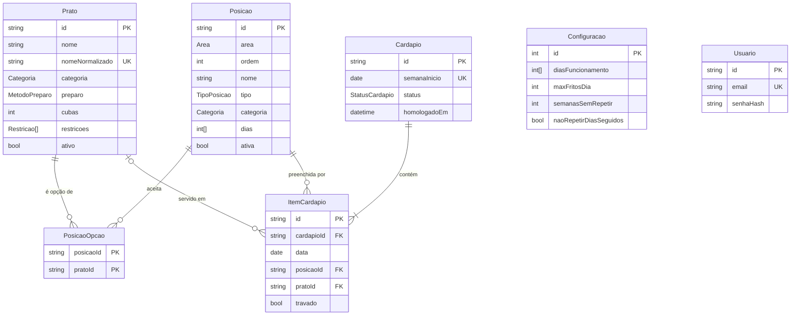

# Modelo de dados

Fonte da verdade: `prisma/schema.prisma`. Regras de negócio em `docs/PLANEJAMENTO.md` §3.2.

## Decisões

| Decisão                                                 | Motivo                                                                                                                         |
| ------------------------------------------------------- | ------------------------------------------------------------------------------------------------------------------------------ |
| **Posição** como entidade própria (área + ordem + tipo) | O buffet real tem 9 cubas + 7 rechauds + grelha; o gestor pensa em "o que vai na cuba 2", não em "pratos fixos" soltos (RN02). |
| `TipoPosicao` = FIXA, VARIAVEL, LIVRE, SOBRAS           | Cobre arroz/farofa (fixa), feijão/polenta (variável), massa/carne (livre) e a cuba de reaproveitamento (sobras).               |
| Opções de posição em tabela N:N (`PosicaoOpcao`)        | FIXA tem 1 opção, VARIAVEL tem várias; LIVRE usa a categoria.                                                                  |
| `Posicao.dias` vazio = todos os dias                    | Permite posições só de fim de semana (ex.: churrasco sáb/dom).                                                                 |
| Frito = `preparo == FRITADEIRA`                         | Evita campo redundante; o limite de fritos (RN06) conta esses pratos.                                                          |
| `Prato.cubas`                                           | Arroz branco e pastel ocupam 2 cubas na prática.                                                                               |
| `nomeNormalizado` único                                 | Evita duplicados por acento/caixa ("Queijo à Dorê" = "queijo a dore"), essencial na importação dos 1.221 nomes históricos.     |
| `ItemCardapio.pratoId` opcional                         | Posição de sobras fica vazia até o gestor preencher.                                                                           |
| `onDelete: Restrict` em Prato/Posição usados            | Preserva o histórico; pratos e posições são desativados, não apagados.                                                         |
| `Configuracao` com registro único (id = 1)              | Um restaurante só (multi-restaurante está fora do escopo).                                                                     |
| Dias como inteiros 0–6 (0 = domingo)                    | Mesmo padrão do `Date.getDay()` do JavaScript.                                                                                 |
